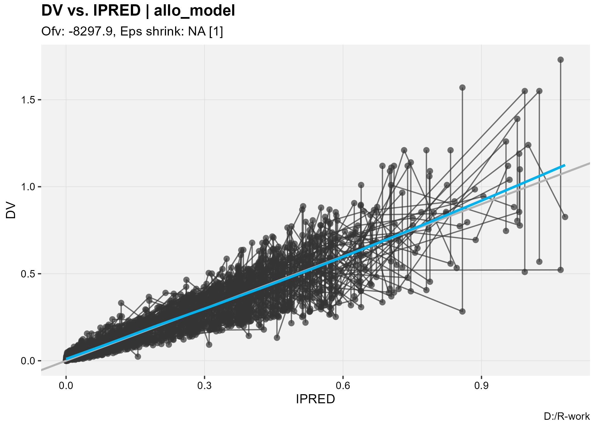

<div align="center">

# Mavoglurant PopPK Analysis using nlmixr2


</div>

A population pharmacokinetic (PopPK) analysis of mavoglurant, implemented with the
[`nlmixr2`](https://nlmixr2.org/) package in R. It is a self-directed modeling exercise that
follows a standard model-development workflow: base structural model → covariate screening →
standard allometric scaling → goodness-of-fit evaluation.

## Dataset

The analysis uses the built-in `mavoglurant` dataset from the `nlmixr2data` package.

| Item | Value |
| --- | --- |
| Subjects | 120 |
| Plasma concentration observations | 2,427 |
| Total records | 2,678 |
| Dose levels | 25, 37.5, 50 mg |
| Administration | Intravenous (constant-rate) infusion |
| Covariates | Body weight (WT), age (AGE) |
| WT, range (mean) | 56.6–115.3 kg (83.2) |
| AGE, range (mean) | 18–50 yr (32.9) |

## Methods

1. **Base model** — a two-compartment disposition model with linear elimination and
   constant-rate intravenous infusion, estimated with FOCEI; inter-individual variability (IIV)
   on clearance (CL) and central volume (V1), plus an additive residual-error model.
2. **Covariate screening** — body weight (WT) and age (AGE) were evaluated as covariates on CL.
3. **Standard allometric scaling** — physiologically based scaling applied to all disposition
   parameters: CL and Q to WT<sup>0.75</sup>, V1 and V2 to WT<sup>1.0</sup>. Scaling all parameters
   together avoids the bias introduced by scaling CL alone.
4. **Goodness of fit** — observed vs. individual predicted concentrations (DV vs. IPRED).

## Results

### Model comparison

| Model | OFV | ΔOFV |
| --- | --- | --- |
| Base (no covariates) | −8257.77 | — |
| + Weight on CL | −8275.80 | 18.03 (vs base) |
| + Weight and age on CL | −8275.79 | −0.007 (vs weight) |
| Final allometric scaling | −8297.93 | 40.16 (vs base) |

- **Weight effect:** adding a single estimated weight effect on clearance significantly improved the
  fit (ΔOFV = 18.03, 1 df, p < 0.001), so body weight is a significant covariate on CL.
- **Age effect:** adding AGE on top of the weight model gave ΔOFV = −0.007, indicating age is not a
  significant covariate for mavoglurant clearance in this dataset, so it was not retained.
- **Final model:** standard allometric scaling (CL and Q scaled to WT<sup>0.75</sup>, V1 and V2 to
  WT<sup>1.0</sup>) lowered the objective function to −8297.93 (ΔOFV = 40.16 vs the base model).
  Because the exponents are fixed, this step adds no estimated parameters, so the OFV drop is not a
  likelihood-ratio test; it reflects the gain from the physiologically based scaling rather than from
  fitting an additional covariate.

### Final parameter estimates

Final model with standard allometric scaling (parameters on the natural-log scale with
back-transformed values):

| Parameter | Meaning | Estimate (log) | SE | %RSE | Back-transformed | 95% CI | BSV (CV%) | Shrinkage (%) |
| --- | --- | ---: | ---: | ---: | ---: | ---: | ---: | ---: |
| tcl | CL — clearance | 3.951 | 0.0724 | 1.83 | 51.98 | 45.10–59.90 | 55.6 | 12.3 |
| tv1 | V1 — central volume | 4.322 | 0.0425 | 0.98 | 75.32 | 69.30–81.85 | 47.4 | 3.69 |
| tq | Q — intercompartmental clearance | 3.657 | 0.0779 | 2.13 | 38.73 | 33.25–45.11 | — | — |
| tv2 | V2 — peripheral volume | 4.567 | 0.215 | 4.70 | 96.29 | 63.21–146.69 | — | — |
| add.sd | Additive residual error (SD) | 0.0987 | 0.00150 | 1.52 | 0.0987 | 0.0957–0.1016 | — | — |

All parameters were estimated with good precision (%RSE < 5%). IIV shrinkage on CL and V1 was
12.3% and 3.7%, respectively, indicating reliable individual parameter estimates.

### Goodness of fit



DV versus IPRED for the final model. Points cluster around the line of identity (grey), with a
LOESS trend (blue) tracking it closely across the concentration range — consistent with adequate
model fit and no obvious bias.

## Repository structure

| File | Description |
| --- | --- |
| `Mavoglurant_PopPK_Model.R` | Main R script: base model, stepwise covariate screening (weight, weight+age), final allometric scaling model, and final parameter table export. |
| `Mavoglurant_Final_Model_Summary.csv` | Final model parameter estimates, standard errors, and %RSE (intermediate OFV comparisons are printed to the console). |
| `Mavoglurant_GOF_DV_vs_IPRED.png` | Goodness-of-fit plot for the final model (DV vs. IPRED). |

## Environment & dependencies

- R (>= 4.0)
- `nlmixr2`
- `nlmixr2data`
- `knitr`

## How to run

1. Install R and RStudio.
2. Install the required packages:

   ```R
   install.packages(c("nlmixr2", "nlmixr2data", "knitr"))
   ```

3. Source `Mavoglurant_PopPK_Model.R`. The script loads the data, fits the base, weight, weight+age,
   and final allometric models, prints all intermediate OFV comparisons, and exports the final
   parameter table to CSV.

## Notes

- The script implements the full stepwise covariate screening workflow: base model → weight effect
  estimation → age effect estimation → final model with standard allometric scaling. All
  intermediate OFV comparisons are printed in the console upon sourcing.
- The script rescales the observed concentrations (DV divided by 1000) before fitting; the
  estimates above are reported in the model's native units.
